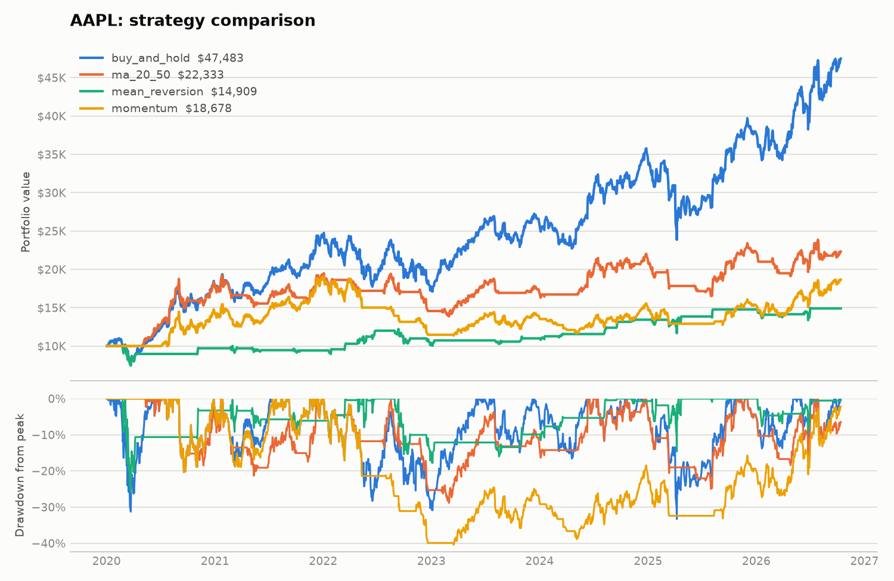

# Quant Backtester

[](https://github.com/AD-Moore/Backtester/actions/workflows/tests.yml)

A modular Python backtesting framework for designing, testing, and evaluating algorithmic trading strategies on historical market data. Built from scratch rather than on top of an existing backtesting library, to understand how each piece — data handling, strategy logic, execution simulation, performance measurement — actually works.



---

## What It Does

- **Data pipeline** — downloads daily OHLCV data with `yfinance`, cleans it, derives returns and rolling volatility, and caches everything as parquet
- **Four strategies behind one interface** — buy-and-hold, moving average crossover, mean reversion (z-score), and time-series momentum
- **Event-driven engine** — walks the data day by day, fills each signal at the *next* day's open to avoid lookahead bias, and charges commission and slippage on every fill
- **Trade log** — every completed round trip is recorded with its fill prices, costs, and net P&L
- **Performance report** — total return, CAGR, volatility, Sharpe, Sortino, max drawdown, Calmar, trade count, win rate, average trade return, and profit factor
- **Comparison chart** — equity curves and drawdowns for every strategy on one figure
- **80 unit and integration tests**, run on every push by GitHub Actions

---

## Results

All four strategies on AAPL, 2020-01-02 to 2026-10-13, starting with $10,000, paying 0.10% commission and 0.05% slippage on every fill:

| Strategy | Total return | CAGR | Volatility | Sharpe | Max drawdown | Trades | Win rate |
|---|---:|---:|---:|---:|---:|---:|---:|
| Buy and hold | +374.8% | 25.9% | 31.1% | 0.90 | -33.3% | 0 | – |
| MA crossover (20/50) | +123.3% | 12.6% | 20.4% | 0.69 | -28.9% | 20 | 40% |
| Mean reversion (20-day, z = 2) | +49.1% | 6.1% | 19.3% | 0.40 | -25.8% | 26 | 62% |
| Momentum (126-day) | +86.8% | 9.7% | 21.9% | 0.53 | -40.4% | 28 | 36% |

What the numbers say:

- **Nothing beat buy-and-hold on AAPL**, on raw return or on Sharpe. Each timing strategy spent long stretches in cash during a period when the stock mostly went up. The same was true on raw return for all six tickers tested (AAPL, MSFT, GOOGL, NVDA, VGT, VOO).
- **Timing mostly bought lower risk, not higher return.** The crossover and mean reversion strategies ran at roughly two-thirds of buy-and-hold's volatility with shallower drawdowns. The one case where that was worth it on a risk-adjusted basis was momentum on VOO: Sharpe 1.03 against 0.82 for buy-and-hold, with a max drawdown of -20.4% against -33.7%.
- **Win rate is a poor guide to profitability.** Mean reversion won 62% of its trades and made the least money; the crossover won 40% and made more than twice as much, because its winners were much larger than its losers.
- **Costs matter.** Removing commission and slippage lifts the crossover's total return from +123.3% to +137.1% — about 14 points from 40 fills.

These are in-sample results over a single, mostly rising period with default parameters. They show the framework working, not strategies anyone should trade.

---

## Setup

```bash
git clone https://github.com/AD-Moore/Backtester.git
cd Backtester
python -m venv .venv
source .venv/bin/activate  # or .venv\Scripts\activate on Windows
pip install -r requirements.txt
```

## Usage

Run everything from the repository root. The data scripts are run as modules (`-m`) so their imports resolve.

```bash
python -m data.downloader   # fetch raw OHLCV data for the configured tickers
python -m data.processor    # clean raw data and compute derived columns
python main.py              # backtest every strategy on AAPL and save a chart
pytest                      # run the test suite
```

`main.py` options:

```bash
python main.py --ticker NVDA                          # a different ticker
python main.py --strategies buy_and_hold momentum     # a subset of strategies
python main.py --commission 0 --slippage 0            # frictionless run
python main.py --cash 50000 --detail                  # full report per strategy
python main.py --no-plot                              # skip the chart
```

The chart is saved to `results/<TICKER>_comparison.png`.

Using the pieces directly:

```python
from data.loader import load_ticker
from engine.backtest_engine import BacktestEngine
from performance.metrics import print_performance_report
from strategies.moving_average_crossover import MovingAverageCrossover

df = load_ticker("AAPL")
strategy = MovingAverageCrossover(short_window=20, long_window=50)

engine = BacktestEngine(
    df, strategy, initial_cash=10_000.0, symbol="AAPL",
    commission_rate=0.001, slippage=0.0005,
)
equity_curve = engine.run()   # pd.Series of portfolio value over time
trades = engine.trades        # list of completed round-trip Trade records

print_performance_report("AAPL / ma_20_50", equity_curve, trades=trades)
```

Adding a strategy means subclassing `Strategy` and returning one signal per row:

```python
from strategies.strategy_base import Strategy

class MyStrategy(Strategy):
    def generate_signals(self, df):
        ...  # pd.Series of 1 (long) / 0 (flat), indexed like df
```

---

## Project Structure

```text
Backtester/
│
├── data/
│   ├── raw/                    # downloaded parquet (git-ignored)
│   ├── processed/              # cleaned parquet (git-ignored)
│   ├── config.py
│   ├── downloader.py
│   ├── loader.py
│   └── processor.py
│
├── strategies/
│   ├── strategy_base.py
│   ├── buy_and_hold.py
│   ├── moving_average_crossover.py
│   ├── mean_reversion.py
│   └── momentum.py
│
├── engine/
│   ├── backtest_engine.py
│   ├── portfolio.py
│   ├── position.py
│   ├── order.py
│   └── trade.py
│
├── performance/
│   ├── metrics.py
│   └── visualization.py
│
├── utils/
│   └── logger.py
│
├── test/                       # pytest suite
├── docs/                       # chart used in this README
├── results/                    # generated charts (git-ignored)
├── .github/workflows/tests.yml
│
├── main.py
├── requirements.txt
└── README.md
```

---

## Design Decisions

A few choices in this codebase are deliberate rather than incidental, worth calling out for anyone reading the code:

**One-directional layering.** `data/` → `strategies/` → `engine/` → `performance/`, with `main.py` orchestrating all of them. Each layer only knows the shape of what it receives (a DataFrame in, a Series out) — a strategy has never heard of cash, and the engine has never heard of yfinance. That's what lets strategies be swapped without touching the engine, or the data source changed without touching strategies.

**Lookahead-bias avoidance.** `BacktestEngine` fills a signal generated from day T's Close at day T+1's Open, never at T's own Close. Filling at the same day's close would mean trading on a price that wasn't actually knowable at the moment of the trade — a common way backtests silently overstate performance. The test suite enforces the same property on the strategy side: every strategy's signal for day T must be identical whether or not it is shown the days after T.

**Costs are applied where they happen.** Slippage moves the fill price against the trade (buys fill higher, sells lower); commission is a cash charge on the traded value. Position sizing leaves room for the commission, so a buy never fails for lack of the fee. Each `Trade` keeps its real fill prices and commissions, so trade statistics are net of costs rather than adjusted afterwards.

**Immutability where it represents a fact, not evolving state.** `Order` and `Trade` are frozen dataclasses because they're records of something that happened at a point in time. `Position` and `Portfolio` are mutable because they represent state that changes as fills happen.

**Fail loudly, close to the source.** Empty API responses, missing columns, invalid order sides, overselling a position, insufficient cash, negative costs, nonsensical strategy parameters — each raises a specific exception naming exactly what went wrong, rather than continuing with bad state.

**Tests use numbers small enough to check by hand.** Engine tests run on four days of prices where Open and Close differ, so a test can tell which price a fill used. Metric tests compare against values computed from the definition.

**Simplifications are named, not hidden.** The current version assumes all-in-or-flat position sizing, whole shares only, a single symbol per run, long-only trading (a short signal is treated as flat), and a 0% risk-free rate by default in the Sharpe and Sortino calculations. Costs are a flat percentage rather than a model of spread or market impact. None of these are accidental gaps — they're tracked on the roadmap below.

---

## Roadmap

- [x] Download and cache historical market data
- [x] Clean data and derive return/volatility columns
- [x] Define a common strategy interface
- [x] Build the backtest engine (order execution, position tracking, portfolio state)
- [x] Implement buy-and-hold and moving average crossover strategies
- [x] Compute performance metrics (Sharpe, Sortino, max drawdown, CAGR, Calmar)
- [x] Implement mean reversion and momentum strategies
- [x] Track individual trades (count, win rate, avg trade return, profit factor)
- [x] Add transaction costs and slippage modeling
- [x] Visualize results (equity curve, drawdown chart)
- [x] Command-line interface and continuous integration
- [ ] Out-of-sample testing (train/test split, walk-forward parameter selection)
- [ ] Support fractional shares, short positions, and multi-symbol portfolios
- [ ] Portfolio optimization across strategies/assets

---

## Technologies

- Python
- pandas / NumPy
- yfinance
- Matplotlib
- pytest, GitHub Actions

---

## What I'm Learning

Python for data/finance work, software design (modular architecture, separation of concerns), object-oriented design for the strategy/engine layer, and the mechanics of backtesting — including the parts that are easy to get subtly wrong, like avoiding lookahead bias and accounting for realistic trading costs.

---

## Author

Andrew D. Moore
